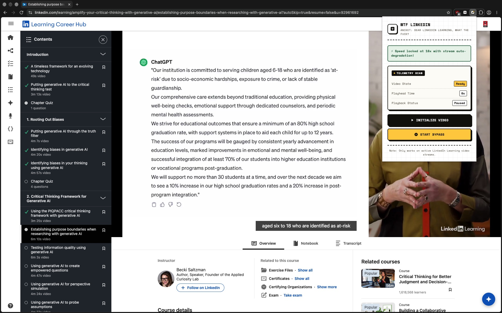
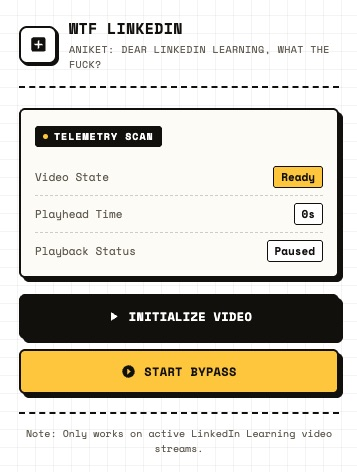

# WTF LinkedIn Learning

[](https://github.com/chrollovale/WTF-LinkedIn-Learning/releases/latest)
[](https://developer.chrome.com/docs/extensions/mv3/intro/)
[](https://github.com/chrollovale/WTF-LinkedIn-Learning)
[](./LICENSE)

<a href="https://github.com/chrollovale/WTF-LinkedIn-Learning/releases/latest"><b>📥 Download WTF-LinkedIn-Learning Extension (.zip)</b></a>

> Built by Aniket — "Dear LinkedIn Learning, what the fuck?"

A clean, open-source Chrome extension that bypasses LinkedIn Learning's video-progress tracking — mark videos and readings as complete instantly, without sitting through them or leaving a tab playing in the background.



## Features

- Instantly registers the current video as watched
- Automatically dismisses popups that would otherwise need human attention (e.g. "are you still watching?" prompts)
- Live telemetry panel (playhead time, playback state) in the popup
- No background tabs left running
- Manifest V3 — works on Chrome, Edge, Brave, and other Chromium browsers

## Known Limitations

Quizzes and a few other popup types can still appear. You don't need to interact with them, though — they auto-redirect into the next video on their own, so the course still completes without you touching anything.



## Installation

Pick whichever fits you:

| | Quick Install | Build from Source |
|---|---|---|
| Best for | Just want to use it | Want to read/modify the code first |
| Requires | Nothing extra | Node.js + npm |
| Result | Uses the prebuilt `dist/` folder as-is | Regenerates a fresh `dist/` yourself |

### Option A — Quick Install (uses the prebuilt `dist/` folder)

1. Click the green **Code** button above → **Download ZIP**.
2. Unzip the downloaded file.
3. In Chrome, go to `chrome://extensions`.
4. Turn on **Developer mode** (top-right toggle).
5. Click **Load unpacked** and select the `dist` folder from inside the unzipped project — not the outer project folder.
6. The extension icon should now show up in your toolbar.

### Option B — Build from Source

Use this if you'd rather compile the extension yourself rather than trust the committed `dist/` folder.

**Prerequisites:** [Node.js](https://nodejs.org) (includes npm).

```bash
git clone https://github.com/chrollovale/wtf-linkedin-learning.git
cd wtf-linkedin-learning
npm install
node build.js
```

This bundles `src/` into a fresh `dist/` folder. Then follow steps 3–6 from Option A, loading your newly built `dist` folder instead.

## Usage

1. Open a LinkedIn Learning course or video page.
2. Click the extension icon in your toolbar.
3. Click **Initialize Video** to detect the current player.
4. Click **Start Bypass**.

## How It Works

Once bypass mode is switched on, the injected script takes over the page's own video player:

- **Playback speed** is pinned to a fixed, very high rate regardless of what LinkedIn's own player tries to set.
- **Video quality** is automatically dropped to the lowest available resolution to avoid buffering delays.
- **Interruption popups** — "Skip," "Continue," "Skip survey," "Next video," and similar prompts — are detected and dismissed automatically so playback isn't interrupted.
- Once a video ends, the player's **"Next" control** is triggered automatically to advance to the next lesson.
- If playback stalls, the script **nudges the timeline forward** instead of waiting for the video to buffer.
- The script periodically **signals normal playback progress** to the page so LinkedIn's tracking registers the video as being watched.
- Audio is muted for the duration, and the popup UI starts/stops the bypass on the active tab.

See [Known Limitations](#known-limitations) above for what this doesn't cover.

## Project Structure

```
├── build.js         # esbuild bundler + static file copier
├── manifest.json    # Extension manifest (source)
├── package.json
├── src/
│   ├── entries/     # content-bridge.js, inject-entry.js
│   └── ui/popup/    # popup.html, popup.js
├── icon/            # Icons + source logo.svg
└── dist/            # Prebuilt, ready-to-load extension (Option A)
```

## Disclaimer

This project is shared for educational purposes. Using it likely violates LinkedIn Learning's Terms of Service, and if your courses are assigned by an employer or school, bypassing them may carry consequences beyond LinkedIn itself. Use at your own risk.

## License

No license has been specified for this repository yet.

---

### ⭐ Support the Project
If this tool saved you hours or helped complete your coursework, please consider giving it a **Star** on GitHub!
